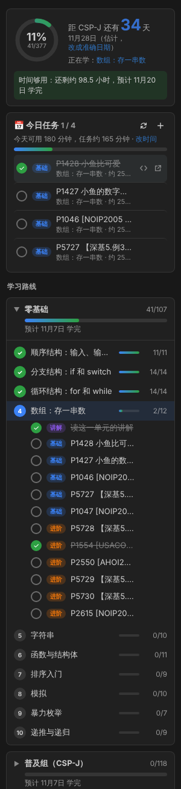

# OI 学习助手

> 起初是写给继承我这台机器的学弟学妹，后来想想，每一个刚走进机房、不知道从哪开始的 OIer 都用得上。

一个 VS Code 插件，给所有学 OI 的同学用，尤其是刚入门、身边没人带的：不知道先学什么、不知道离考试还有多少时间够不够，打开它就有答案。左边栏有两个图标：

- **📘 学习助手**：从零基础到 NOIP 的学习路线，按考试日期和你每天的时间排好每天的任务，配详细讲解，自动同步洛谷 AC 记录。
- **🏆 比赛助手**：像模拟赛一样，一键编译、运行所有测试点并对比答案；从洛谷一键导入样例；模拟赛倒计时。



## 快速上手

1. 到 [Releases](https://github.com/XMbulaxi/oi-helper/releases) 下载最新的 `oi-helper-x.y.z.vsix`。
2. 在 VS Code 里按 `Ctrl+Shift+P`，输入 `Install from VSIX`（从 VSIX 安装），选择下载的文件，装好后再运行一次 `Reload Window`（重新加载窗口）。
3. 用“文件 → 打开文件夹”打开一个放代码的文件夹。
4. 点左边栏的 **OI 学习助手** 图标，选择起点阶段，再设置目标考试和每天能学多少分钟。
5. 填上洛谷用户名，以后 AC 的题会自动打勾。

写题时点题目旁边的 `</>` 按钮新建代码文件，再打开 **OI 比赛助手** 测样例。

## 学习助手

- **三个阶段，从零基础到 NOIP**：零基础（10 个单元，C++ 语法到递归）、普及组 / CSP-J（14 个单元，高精度到最短路）、提高组 / CSP-S · NOIP（24 个单元，分治、线段树、各类 DP、Tarjan、KMP、数论到真题综合），共 329 道洛谷题。
- **题目分基础和进阶**：每个单元先读讲解，再做基础题，最后做进阶题。
- **详细讲解**：每个单元一篇，包括原理、手推例子、C++ 模板、常见错误、每道题的做题提示和自测题。
- **按考试排计划**：选目标考试（CSP-J / CSP-S / NOIP）和考试日期，填上学日和周末每天能学多少分钟。插件按每项任务的预计用时排出每天的任务，并告诉你：
  - 时间够用：预计哪天学完；
  - 时间只够做基础题：先做所有基础题，进阶题考后再做；
  - 时间紧：考前大约能学到哪个单元。
- **学习面板**：顶部是考试倒计时和总进度，下面是今日任务和整条路线的进度条。点任务左边的圆圈打勾；今天的任务一天之内不会变，做完了可以点 **+** 再加一项。
- **洛谷同步**：AC 的题自动打勾，同步不了时也可以手动打勾。
- **新建代码文件**：自动在 `luogu/` 文件夹里建好 `P1001.cpp`，写好头文件和题目链接。

考试日期默认是估计的（CSP 按十月最后一个周六，NOIP 按十一月最后一个周六），CCF 公布日期后请在“目标和时间”里改成准确日期。

## 比赛助手

点左边栏的奖杯图标打开。它会显示当前打开的 `.cpp` 文件的所有测试点，点顶部的“切换文件”可以换一个文件。

- **运行**：按 `Ctrl+Alt+T`，或者点面板里的“▶ 全部运行”（编辑器右上角也有 ▶）。每个测试点显示 AC / WA / TLE / RE 和用时，最上面显示总分。答案错误时会显示你的输出，并指出第几行不一样。每个测试点旁边的 ▶ 可以只运行这一个。
- **加样例**：点“+ 新增样例”，把题目里的输入、输出粘贴进去就行，会自动存成文件。
- **从洛谷一键导入**：在浏览器装 [Competitive Companion](https://github.com/jmerle/competitive-companion) 扩展（Chrome 和 Firefox 都有）。在 VS Code 打开放代码的文件夹，再在浏览器打开洛谷题目页，点扩展的绿色加号，插件会自动建好 `luogu/P1001.cpp`、存好样例、用上题目的时间限制。Codeforces、AtCoder 等网站也能用。如果你也装了 CPH 插件，两个会抢同一个端口，只留一个开着接收即可。
- **模拟赛计时**：点面板右上角的表，选比赛时长，状态栏会倒计时，剩 30、15、5 分钟时提醒。

测试点文件放在代码旁边的同名文件夹里，例如 `luogu/P1001.cpp` 对应 `luogu/P1001/1.in`、`1.out`……（答案也可以叫 `.ans`）。模拟赛发下来的数据文件夹可以点面板里的 📁 选择。

需要电脑上装有 g++（Windows 可以装 MinGW-w64，或者用 Dev-C++ 自带的）。如果提示找不到编译器，在设置 `oiHelper.compiler` 里填 g++ 的完整路径。

- 比较方式和大多数 OI 评测一样：忽略行末空格和文件末尾的空行，其他必须完全一致。
- 用了 `freopen("P1001.in", "r", stdin)` 这种文件读写的代码也能测（文件名要和代码文件名一样）。
- 编译参数默认是 `-O2 -std=c++14`，和 CSP/NOIP 考场一致，可以在设置 `oiHelper.compileArgs` 里改。
- 用时是在自己电脑上测的，只能参考。插件不限制内存。

## 洛谷同步说明

洛谷没有官方公开的接口，插件读取的是洛谷网页"练习"页面用的数据。

- 在设置 `oiHelper.luoguUser` 里填用户名或 UID。
- 如果提示需要登录：在浏览器登录洛谷，按 F12 打开开发者工具，在"应用 / Application → Cookies → https://www.luogu.com.cn"里找到 `__client_id` 和 `_uid` 两行，按 `__client_id=xxx; _uid=xxx` 的格式拼好。然后在 VS Code 里按 `Ctrl+Shift+P`，运行"设置洛谷 Cookie"，粘贴进去。Cookie 只保存在你自己的电脑上，**不要发给别人**。在浏览器里退出洛谷登录会让这个 Cookie 失效，到时重新复制一次即可。
- 如果洛谷改了网页导致同步失败，需要修改的代码在 `src/luogu.ts`。
- 维护内容时可以运行“用洛谷核对题目”命令（学习助手面板右上角的 `…` 菜单里），插件会逐题去洛谷查题名，列出对不上的题。

## 怎么改内容（不用会写代码）

所有内容都在 `content/` 文件夹里：

```
content/
  routes/zero.json      零基础阶段：单元、题目
  routes/puji.json      普及组阶段
  routes/tigao.json     提高组阶段
  lessons/zero/*.md     零基础阶段的讲解
  lessons/puji/*.md     普及组阶段的讲解
  lessons/tigao/*.md    提高组阶段的讲解
```

每个阶段文件开头的 `minutes` 是预计用时（分钟）：`basic` 是一道基础题，`advanced` 是一道进阶题，`lesson` 是读一篇讲解。

**加一道题**：在对应单元的 `problems` 里加一行 `{ "pid": "P1234", "title": "题目名", "level": "basic" }`。`level` 填 `basic`（基础）或 `advanced`（进阶）。某道题特别难或特别简单时，可以加 `"minutes": 150` 单独设置预计用时。同一道题不要在两个单元里重复出现。

**加一个单元**：在 `units` 里加一项，写好 `id`、`title`、`lesson`（讲解文件路径）和 `problems`，再在 `lessons/` 里新建对应的 `.md` 文件。

改完后运行 `npm test`，它会检查讲解文件是否存在、题号格式是否正确、每个单元有没有基础题、有没有重复的题。之后可以在 VS Code 里运行“用洛谷核对题目”，确认题号和题名对得上。

## 开发

需要 Node.js 18 以上。

```bash
npm install
npm test          # 编译并运行测试
npm run package   # 打包成 .vsix
```

在 VS Code 里打开本文件夹，按 F5 可以启动一个装好插件的调试窗口。

代码结构：

- `src/plan.ts`：考试计划、每日任务和进度预测（纯逻辑，有单元测试）
- `src/luogu.ts`：洛谷同步
- `src/judge.ts`：编译、运行测试点、比较输出（有单元测试）
- `src/home.ts`：学习助手面板
- `src/contest.ts`：比赛助手面板、Competitive Companion 导入、模拟赛计时
- `src/extension.ts`：命令、设置和本地存储

## 许可

MIT
